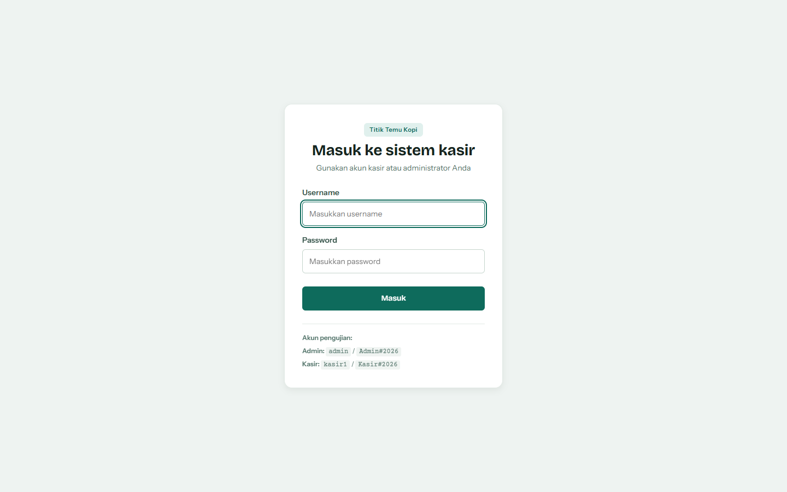
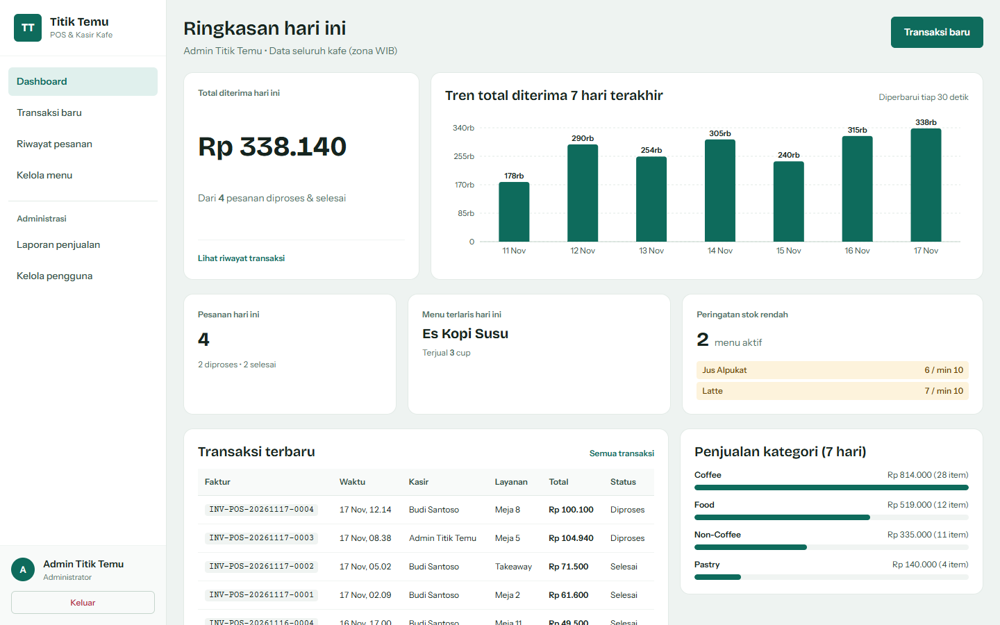
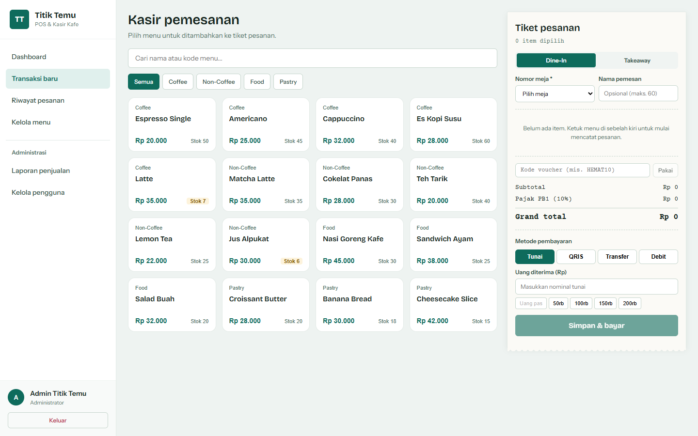
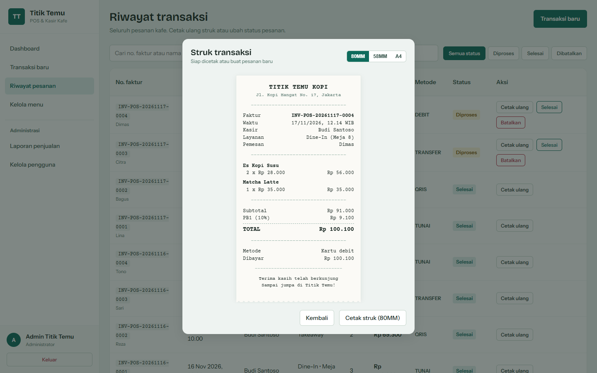
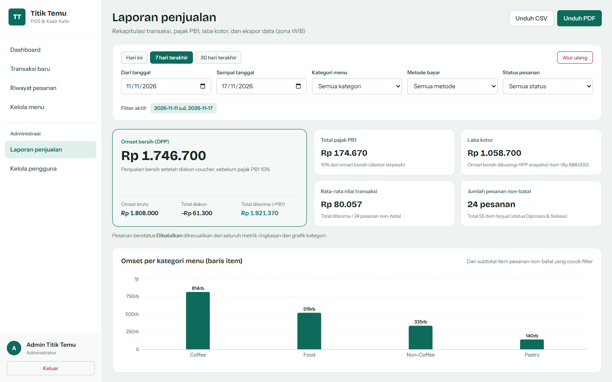

# Sistem Kasir & Pemesanan Kafe Modern — Titik Temu Kopi (`MED-WEB-01`)

Aplikasi web Point of Sales (POS) terintegrasi untuk layanan **Dine-In** dan **Takeaway** pada kafe *Titik Temu Kopi*. Dirancang dengan arsitektur modular, keamanan berlapis, performa transaksi tinggi dengan proteksi ACID, serta pengalaman pengguna yang responsif.

---

## 1. Teknologi & Arsitektur

### Backend
- **Runtime & Framework**: Node.js 20 LTS & Express.js.
- **Basis Data**: PostgreSQL 14+ menggunakan driver native `pg` dengan **100% Parameterized Raw SQL Query** (tanpa ORM/Query Builder) untuk performa maksimal dan proteksi total terhadap SQL Injection.
- **Validasi Data**: `zod` (`^4.6.7`) untuk validasi skema request body, query parameter, dan sanitasi input.
- **Autentikasi & Enkripsi**:
  - `bcrypt` (`^6.0.0`) untuk hashing password satu arah.
  - `jsonwebtoken` (`^9.0.2`) dengan token JWT disimpan secara aman pada cookie `httpOnly`, `sameSite: 'lax'`, dan otomatis `secure: true` pada environment produksi.
- **Keamanan & Rate Limiting**:
  - `helmet` untuk proteksi header HTTP (CSP, X-Frame-Options, dsb).
  - `express-rate-limit` untuk pencegahan brute-force login.
  - `cors` dengan konfigurasi origin ketat berbasis environment (`CLIENT_ORIGIN`).
- **Generasi Dokumen**: `pdfkit` untuk rendering dokumen PDF rekap laporan penjualan berformat tabel A4 landscape resmi.

### Frontend
- **Framework & Tooling**: React 18 + Vite 6 (JavaScript Modern ES Modules).
- **Routing**: React Router v6 dengan *Protected Route Guards* berbasis peran (`admin` / `kasir`).
- **State & Server Cache**: TanStack Query v5 (`@tanstack/react-query`) untuk sinkronisasi state data, background refetching, dan manajemen status jaringan.
- **Visualisasi Data**: Recharts 2 dengan *code-splitting* dinamis (`React.lazy` + `Suspense`) sehingga chunk analitik dimuat terpisah.
- **Desain & Tipografi**:
  - CSS Custom Properties (Design Tokens): *Embun*, *Tinta Teh*, *Hijau Pandan*, *Kunyit*, *Delima*, dan *Kertas*.
  - Tipografi: *Plus Jakarta Sans* (Heading & UI), *Instrument Sans* (Body), *Times New Roman* (Aksen Branding POS), dan *Courier Prime* (Struk Termal POS).

---

## 2. Algoritma, Integritas Transaksi & Mekanisme Teknis

1. **Algoritma Hashing Password (Bcrypt Cost 10)**:
   - Password disimpan dalam format hash Bcrypt dengan salt cost 10 (`$2b$10$...`).
   - Panjang password minimal 8 karakter diwajibkan saat pembuatan akun dan reset password.
   - Pesan error login dibuat seragam (*"Username atau password tidak sesuai."*) untuk mencegah teknik *username enumeration*.

2. **Integritas Transaksi ACID & Row-Level Locking**:
   - Pembuatan pesanan dibungkus dalam blok transaksi basis data (`BEGIN ... COMMIT / ROLLBACK`).
   - Pengurangan stok barang menggunakan klausa `SELECT stok FROM products WHERE id = $1 FOR UPDATE` untuk mencegah *race condition* dan *overselling* saat beberapa kasir bertransaksi serentak.
   - Jika stok tidak mencukupi, transaksi otomatis di-rollback dan mengembalikan kode status HTTP `409 Conflict`.

3. **Penomoran Faktur Atomik Unik Tanpa Celah (`order_counters`)**:
   - Format nomor faktur: `INV-POS-YYYYMMDD-XXXX` (contoh: `INV-POS-20261117-0001`).
   - Nomor urut disimpan dalam tabel `order_counters` dan dikunci menggunakan `SELECT nomor_terakhir FROM order_counters WHERE tanggal = $1 FOR UPDATE`.
   - Mengeliminasi risiko nomor faktur ganda atau celah penomoran (*gapless sequencing*) meskipun ada pesanan yang dibatalkan atau gagal di tengah jalan.

4. **Proteksi Idempotensi Transaksi (`Idempotency-Key`)**:
   - Setiap percobaan checkout kasir menyertakan header `Idempotency-Key` unik berbasis UUIDv4.
   - Backend memverifikasi hash payload pesanan dengan SHA-256. Request berulang dengan kunci yang sama akan mengembalikan pesanan yang sama tanpa memotong stok dua kali.

5. **Sliding-Window Rate Limiting Login**:
   - Dibatasi maksimal 10 percobaan gagal per 15 menit per IP (`skipSuccessfulRequests: true`).
   - Percobaan login yang sukses tidak memotong kuota limiter, sementara kegagalan ke-11 akan ditolak dengan status HTTP `429 Too Many Requests`.

6. **Perhitungan Finansial & Pajak Restoran PB1 10%**:
   - Seluruh nominal uang disimpan dalam tipe data integer rupiah (`INTEGER`) untuk mencegah kesalahan desimal floating-point.
   - Nilai subtotal dihitung ulang oleh server berdasarkan data produk terbaru.
   - Pajak Restoran PB1 (10%) dihitung dari Dasar Pengenaan Pajak (DPP = `subtotal - diskon`), dibulatkan ke rupiah terdekat:
     $$\text{Pajak Nominal} = \text{ROUND}((\text{Subtotal} - \text{Diskon}) \times 0.1)$$
     $$\text{Grand Total} = \text{Subtotal} - \text{Diskon} + \text{Pajak Nominal}$$

7. **Tie-Breaker Deterministik Menu Terlaris**:
   - Penentuan menu terlaris pada dashboard dihitung dari agregasi `SUM(kuantiti)`.
   - Jika terdapat kuantiti yang sama (seri), diurutkan secara deterministik berdasarkan abjad nama menu: `ORDER BY total_qty DESC, nama_produk ASC`.

8. **Proteksi Konfigurasi Produksi (*Production Hardening*)**:
   - Fungsi `validateProductionConfig` menolak startup server pada `NODE_ENV=production` jika `JWT_SECRET` kurang dari 32 karakter, menggunakan pola lemah, atau jika `CLIENT_ORIGIN=*`.
   - Middleware error 500 menyamarkan pesan database, menyembunyikan query SQL, dan menghilangkan *stack trace* dari respon JSON klien.

---

## 3. Skema Basis Data

Basis data terdiri dari 5 tabel inti dan 2 tabel pembantu yang didefinisikan secara konsisten pada [database.sql](database.sql) dan migrasi backend:

```
├── users               : Data kredensial pengguna, peran (admin/kasir), status aktif/nonaktif
├── categories          : Master kategori menu (Coffee, Non-Coffee, Food, Pastry)
├── products            : Master menu, kode produk, harga jual, harga pokok (HPP), stok, unit
├── orders              : Header transaksi, faktur, tipe (dine_in/takeaway), meja, kalkulasi, status
├── order_details       : Rincian item pesanan, snapshot harga jual & HPP saat transaksi, catatan khusus
├── order_counters      : Urutan penomoran faktur atomik harian per tanggal
└── stock_adjustments   : Rekam jejak audit riwayat perubahan stok masuk/keluar oleh admin
```

---

## 4. Akun Pengujian

| Peran (*Role*) | Username | Password | Wewenang Akses |
| :--- | :--- | :--- | :--- |
| **Administrator** | `admin` | `Admin#2026` | Akses penuh: Dashboard eksekutif, Kelola Menu & Kategori, Manajemen Stok & HPP, Laporan Penjualan & Ekspor, Kelola Pengguna Kasir. |
| **Kasir / Waiter** | `kasir1` | `Kasir#2026` | Akses operasional: Pembuatan pesanan POS, Cetak Struk, Riwayat Transaksi mandiri, Dashboard ringkas khusus transaksi pribadi. |

---

## 5. Prasyarat Sistem

- **Node.js**: Versi 20 LTS atau lebih baru.
- **npm**: Versi 10 atau lebih baru.
- **PostgreSQL**: Versi 14 atau lebih baru (default port `5432`).
- **Google Chrome**: (Opsional, hanya dibutuhkan jika ingin menjalankan pengujian otomatis E2E).

---

## 6. Petunjuk Instalasi & Menjalankan (5–10 Menit)

### A. Konfigurasi Awal
1. Clone repositori ke komputer lokal Anda:
   ```bash
   git clone <URL_REPOSITORI_ANDA>
   cd titik_temu_pos
   ```

2. Konfigurasi Environment Backend:
   Masuk ke folder `server/`, salin berkas `.env.example` menjadi `.env`:
   ```bash
   cd server
   cp .env.example .env     # Linux / macOS
   copy .env.example .env   # Windows (CMD / PowerShell)
   ```
   Buka berkas `server/.env` dan sesuaikan kredensial PostgreSQL lokal Anda:
   ```env
   PORT=3001
   NODE_ENV=development
   DB_HOST=localhost
   DB_PORT=5432
   DB_NAME=titik_temu_pos
   DB_USER=postgres
   DB_PASSWORD=password_postgres_anda
   JWT_SECRET=rahasia_jwt_minimal_32_karakter_acak_dan_aman_2026
   CLIENT_ORIGIN=http://localhost:5173
   ```

---

### B. Inisialisasi Basis Data (Pilih Salah Satu Opsi)

#### Opsi 1 — Menggunakan Skrip Otomatis Backend (Direkomendasikan)
Skrip ini akan membuat database `titik_temu_pos`, menjalankan migrasi tabel, dan menginjeksi seed data demo secara otomatis:
```bash
cd server
npm install
npm run db:setup
```

#### Opsi 2 — Impor Manual `database.sql` via `psql`

**Windows (PowerShell):**
```powershell
$env:PGPASSWORD = "password_postgres_anda"
# 1. Buat database baru
& "C:\Program Files\PostgreSQL\18\bin\psql.exe" -U postgres -d postgres -c "CREATE DATABASE titik_temu_pos ENCODING 'UTF8';"

# 2. Impor struktur dan data awal
& "C:\Program Files\PostgreSQL\18\bin\psql.exe" -U postgres -d titik_temu_pos -v ON_ERROR_STOP=1 -f ".\database.sql"
```

**Linux / macOS (Bash / Zsh):**
```bash
export PGPASSWORD="password_postgres_anda"
# 1. Buat database baru
psql -U postgres -d postgres -c "CREATE DATABASE titik_temu_pos ENCODING 'UTF8';"

# 2. Impor struktur dan data awal
psql -U postgres -d titik_temu_pos -v ON_ERROR_STOP=1 -f "./database.sql"
```

---

### C. Menjalankan Aplikasi

1. **Jalankan Backend Server**:
   ```bash
   cd server
   npm run dev
   ```
   *Backend API aktif di `http://localhost:3001`.*

2. **Jalankan Frontend Client** (Buka terminal baru):
   ```bash
   cd client
   npm install
   npm run dev
   ```
   *Frontend aktif di `http://localhost:5173`.*

Buka browser dan akses `http://localhost:5173`, kemudian masuk menggunakan akun pengujian di atas.

---

## 7. Panduan Fitur per Modul

1. **Modul Autentikasi & Akun**:
   - Form login dengan validasi interaktif dan proteksi rate limit 10 percobaan gagal.
   - Manajemen akun pengguna oleh Admin: tambah akun kasir, nonaktifkan akun, dan reset password minimal 8 karakter.
2. **Modul Transaksi Kasir (POS)**:
   - Pencarian menu real-time dan filter kategori instan.
   - Pemilihan tipe layanan **Dine-In** (wajib memilih nomor meja 1–30) atau **Takeaway**.
   - Input kuantiti dinamis dan tombol pintas catatan khusus (*Less sugar*, *Extra ice*, *No onion*).
   - Validasi stok langsung pada kartu menu; item habis otomatis dinonaktifkan.
   - Perhitungan kembalian tunai otomatis dan pilihan nominal uang cepat.
   - Modal struk termal belanja siap cetak ukuran 58mm, 80mm, dan A4.
3. **Modul Riwayat Transaksi**:
   - Tampilan daftar riwayat pesanan dengan filter status (*Diproses*, *Selesai*, *Dibatalkan*).
   - Kasir hanya melihat transaksi milik pribadi; Admin dapat melihat dan membatalkan pesanan kafe secara menyeluruh.
   - Pembatalan transaksi otomatis mengembalikan kuantiti stok ke master produk secara akurat.
4. **Modul Dashboard Eksekutif**:
   - Metrik KPI real-time: Total Diterima Hari Ini, Jumlah Transaksi, Menu Terlaris, dan Peringatan Stok Rendah.
   - Grafik batang interaktif Recharts tren pendapatan 7 hari terakhir.
   - Tabel 5 transaksi kasir terbaru dengan tautan cepat ke kasir pemesanan.
5. **Modul Laporan & Ekspor**:
   - Filter multi-dimensi: rentang tanggal kalender, kategori menu, metode pembayaran, dan status transaksi.
   - Rekapitulasi 5 metrik statistik: Omset Bruto, Total Diskon, Total Pajak PB1, Omset Bersih, dan Average Order Value (AOV).
   - Rekonsiliasi angka hari ini sinkron 100% antara Laporan dan Dashboard.
   - Ekspor laporan dalam format **Spreadsheet CSV** (kompatibel Excel Indonesia dengan BOM UTF-8 dan pemisah koma otomatis).
   - Ekspor laporan dalam format **Dokumen PDF Resmi** berformat landscape rapi dengan paginasi halaman.

---

## 8. Petunjuk Menjalankan Pengujian Otomatis

### A. Pengujian Unit & Integrasi Backend (Jest)
Rangkaian pengujian Jest mencakup keamanan, kalkulasi pajak PB1, isolasi transaksi ACID, dan seeder:
```bash
cd server
npm test
```
*Catatan: Jest berjalan sekuensial pada basis data terisolasi `titik_temu_pos_test` yang dibuat dan dihapus secara otomatis.*

### B. Pengujian End-to-End Browser (Puppeteer)
Pengujian E2E memvalidasi seluruh alur antarmuka di peramban Chrome:
```bash
cd server/tests/e2e
PUPPETEER_SKIP_DOWNLOAD=1 npm install

cd ../..
node tests/e2e/run_e2e.mjs tests/e2e/verify_fase1.mjs tests/e2e/verify_fase2.mjs tests/e2e/verify_fase3.mjs tests/e2e/verify_fase4.mjs tests/e2e/verify_fase5.mjs tests/e2e/verify_fase6.mjs
```

### C. Build Produksi Frontend
Untuk memverifikasi kesiapan kompilasi produksi tanpa warning ukuran chunk:
```bash
cd client
npm run build
```

---

## 9. Struktur Direktori Proyek

```
titik-temu-pos/
├── database.sql                  # Dump skema DDL & seed data demo awal
├── README.md                     # Dokumentasi teknis & panduan instalasi
├── .gitignore                    # Aturan pengabaian berkas git
│
├── server/                       # Backend Node.js 20 & Express
│   ├── src/
│   │   ├── config/               # Konfigurasi env, database pool, dan proteksi produksi
│   │   ├── db/                   # Skrip setup, migrasi tabel, dan seed SQL
│   │   ├── middleware/           # Auth guard JWT, requireRole, rate-limiter, errorHandler
│   │   ├── modules/              # Arsitektur modular per fitur
│   │   │   ├── auth/             # Autentikasi login, logout, sesi me
│   │   │   ├── categories/       # Manajemen data kategori produk
│   │   │   ├── products/         # Master menu makanan/minuman & penyesuaian stok
│   │   │   ├── orders/           # Transaksi POS, faktur atomik, dan pembatalan
│   │   │   ├── dashboard/        # Agregasi metrik KPI & grafik tren 7 hari
│   │   │   ├── reports/          # Agregasi laporan laba kotor & ekspor PDF/CSV
│   │   │   ├── users/            # Kelola akun pengguna & reset password
│   │   │   └── vouchers/         # Validasi voucher diskon
│   │   ├── app.js                # Konfigurasi Express app, CORS, dan Helmet
│   │   └── server.js             # Entrypoint server HTTP
│   └── tests/                    # Pengujian Jest & skrip E2E Puppeteer
│
├── client/                       # Frontend React 18 + Vite 6
│   ├── src/
│   │   ├── api/                  # Axios/fetch client & React Query custom hooks
│   │   ├── components/           # Komponen layout (Navbar, Sidebar fixed, Modal, Toast)
│   │   ├── features/             # Halaman fitur UI
│   │   │   ├── auth/             # Halaman Login modern estetis (TMS font)
│   │   │   ├── dashboard/        # Dashboard analitik & grafik batang Recharts
│   │   │   ├── pos/              # Layar kasir pemesanan & riwayat transaksi
│   │   │   ├── menu/             # Kelola master menu & modal stok
│   │   │   ├── reports/          # Laporan penjualan multi-filter & tombol ekspor
│   │   │   ├── receipt/          # Modal nota struk belanja termal 58/80mm/A4
│   │   │   └── users/            # Halaman kelola akun kasir
│   │   ├── styles/               # Design tokens, reset global, dan komponen dasar
│   │   ├── App.jsx               # Deklarasi router & query client provider
│   │   └── main.jsx              # Entrypoint React DOM
│   └── vite.config.js            # Konfigurasi Vite & proxy backend
│
└── docs/                         # Aset dokumentasi tangkapan layar
    └── screenshots/
        ├── login.png
        ├── dashboard.png
        ├── kasir.png
        ├── struk.png
        └── laporan.png
```

---

## 10. Tangkapan Layar Antarmuka

| Layar Login Modern | Dashboard Eksekutif |
| :---: | :---: |
|  |  |

| Layar Kasir Pemesanan (POS) | Cetak Nota Struk Termal |
| :---: | :---: |
|  |  |

| Rekap Laporan Penjualan Multi-Filter |
| :---: |
|  |
